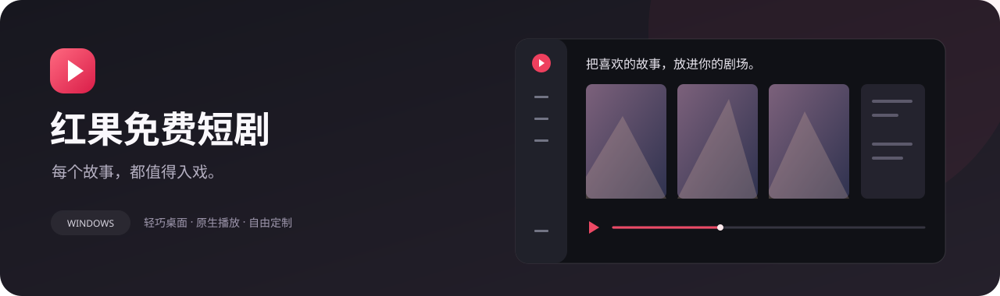

<div align="center">



# 红果免费短剧

**把看剧这件事，留给一个安静、顺手的桌面窗口。**

短剧 · 漫剧 · AI 剧 ｜ Windows 桌面播放器 ｜ 本地收藏与观看记录

[](https://github.com/aemeath01/hongguo-desktop/releases/latest)
[](LICENSE)


[下载安装](https://github.com/aemeath01/hongguo-desktop/releases/latest) · [开始使用](#开始使用) · [快捷键](#快捷键) · [问题反馈](https://github.com/aemeath01/hongguo-desktop/issues) · [参考与致谢](#参考与致谢)

</div>

> **先了解这一点：** 这是独立的桌面前端与播放器项目，并非红果官方客户端。公开包不包含原客户端的私有播放服务、视频或账号凭据；首次使用需安装播放核心，并自行导入已有的播放服务。不能仅凭本仓库保证内容接口一直可用。

## 你可以用它做什么

| 看剧 | 找剧 | 管理与个性化 |
| :--- | :--- | :--- |
| mpv 原生播放、倍速、连续播放 | 三类内容集中探索、在线搜索 | 浅色 / 深色 / 跟随系统 |
| 全屏、画中画、独立收起集数栏 | 去除季数关键词，在线搜索其他季 | 可收起侧栏、主题扩散动效 |
| 点按快进，长按临时倍速 | 首页推荐、热播、新剧、猜你喜欢 | 本地历史、收藏与搜索记录 |
| 当前倍速沿用到下一集 | 多季按季数排序，展开当前播放季 | 缓存清理、模块安装与卸载 |
| 可选画质增强与插帧 | 最近观看记录继续播放 | 签名更新、诊断摘要与反馈草稿 |

## 下载

打开 [最新 Release](https://github.com/aemeath01/hongguo-desktop/releases/latest)，按用途选一个：

| 文件 | 适合谁 | 如何运行 |
| :--- | :--- | :--- |
| `Hongguo-版本号-windows-x64-setup.exe` | 日常使用，推荐 | 按向导安装，支持应用内下载、验证和安装更新 |
| `Hongguo-版本号-windows-x64-portable.zip` | 想放在自选目录或移动磁盘 | 完整解压后运行 `红果免费短剧.exe` |
| `SHA256SUMS.txt` | 需要核对下载文件 | 比对 SHA-256；完整性清单不能替代可信签名 |

需要 Windows 10 / 11 x64、Microsoft Edge WebView2 Runtime，以及可写的应用/数据目录。安装版会按需安装 WebView2；便携版若无法启动，请先安装 [微软 WebView2 Runtime](https://developer.microsoft.com/microsoft-edge/webview2/)。目前不提供 macOS、Linux 或 ARM 原生包。

## 开始使用

1. **启动应用**，进入 **设置 → 模块与存储**。
2. **安装 mpv 播放核心**。应用从上游下载固定版本并核验 SHA-256，约 40 MB；公开包不内置第三方播放内核。
3. **导入播放服务**。选择你已安装的 [原红果桌面客户端](https://github.com/waligoraamodio288-rgb/hongguo-desktop-releases) 中的 `backend` 文件夹。应用复制到自己的数据目录，原目录保持不变。该后端由原项目维护，本仓库不提供其源码或安装包。
4. 点击 **检查播放服务**，返回首页 **刷新剧库**，即可搜索和播放可用内容。

默认数据保存在应用目录下的 `data/`，也可以在设置中更换位置并迁移。收藏、历史、搜索记录、偏好及缓存均保存在本机。不要将整个使用过的应用目录直接上传或发给别人。

### 更新怎么用

- **安装版：** 关于与反馈 → 检查更新 → 下载更新 → 安装并重启。下载后的包必须通过内置公钥验证；不会在观看时强行安装。
- **便携版：** 可以检查新版本，点击前往 Release 下载新的 ZIP。退出程序后覆盖程序文件，保留 `data/` 与 `hongguo-storage.json`。当前不做便携目录的自动替换。
- **从 0.1.8 或更早的本地版升级：** 旧版本尚未配置发布地址，需要先手动安装一次新版本。

更新依赖 GitHub 可用性。首次公开 Release 发布前，检查更新可能返回地址不可用；这不等于“已经是最新版”。

已在 Windows 11 x64 完成 **0.1.9 → 0.1.10** 的检查、下载、安装及重启实测，默认目录与自定义目录中的历史、收藏、设置均保留。详见 [完整测试记录](docs/UPDATE-TEST.md)。从 0.1.10 起，安装登记和快捷方式使用独立标识，便于与同名客户端同时安装。

## 快捷键

| 按键 | 功能 |
| :--- | :--- |
| `空格` | 暂停 / 继续 |
| `←` / `A`，`→` / `D` | 点按快退 / 快进；长按临时倍速，松开恢复 |
| `↑` / `W`，`↓` / `S` | 增加 / 降低音量 |
| `F` | 进入 / 退出全屏 |
| `Esc` | 退出全屏，或关闭播放器 / 弹层 |
| `Ctrl K` | 搜索 |
| 老板键 | 在设置中配置；隐藏窗口并暂停，恢复时保留原先暂停状态 |

长按倍速、快进步长、默认倍速与自动连播可在设置中调整。输入框输入文字时不会触发播放快捷键。全屏与收起集数栏是两个独立操作；全屏控制条自动隐藏，移动鼠标后显示。

## 画质增强与插帧

**默认关闭，按需安装。建议先确认原始画面播放稳定，再逐项开启。**

| 模块 | 作用 | 当前实现与边界 |
| :--- | :--- | :--- |
| mpv 高质量缩放 | 改善缩放观感 | 常规 GPU 缩放，不是 AI 超分 |
| Anime4K | 动漫线条恢复与放大 | S 级着色器，主要面向漫剧 |
| Real-ESRGAN | AI 超分 | 通过 vs-mlrt / ncnn Vulkan，当前模型更适合动漫；不保证真人画面改善 |
| RIFE | 生成中间帧 | 通过 VapourSynth + vs-mlrt；启用前按视频规格检测性能 |

Vulkan 路径面向 **AMD、Intel 核显/独显与 NVIDIA**。兼容性取决于驱动、内存、视频分辨率、帧率和播放倍速，不能只凭显卡品牌判断。当前公开包不附带 OpenVINO 或 TensorRT 后端。

AI 模块首次下载约 900 MB。应用会做有限时间的性能探测，并在持续掉帧或停滞时回退；这不能替代所有设备上的长时间实测。已测试设备上，高分辨率 RIFE 曾无法实时播放，因此不会宣称开启插帧一定更流畅。原始画面仍是最稳妥的默认选择。

## 常见问题

<details>
<summary><b>为什么启动后没有剧库或无法播放？</b></summary>

先安装 mpv，导入有效的 `backend`，再检查连接和刷新剧库。后端接口失效、上游限制或网络故障都可能导致失败。在线搜索找到剧集不代表每一集都有可用播放源。

</details>

<details>
<summary><b>“查找其他季”如何工作？</b></summary>

从剧名中提取不含季数的关键词，调用在线搜索，再按名称相似度与季数整理候选，放到集数栏中。不是只查本机剧库。相似片名、同名改编可能混入结果，请核对剧名与季数后播放。

</details>

<details>
<summary><b>缓存能消除每次换集的等待吗？</b></summary>

缓存可复用已取得的视频文件与片段，但新一集仍可能需要解析、连接或缓冲；过期片源也要重新获取。目前不提供“一键下载全集”，不承诺离线播放全部剧集。

</details>

<details>
<summary><b>如何反馈，又不会带上观看记录？</b></summary>

在“关于与反馈”填写问题，复制反馈草稿，再到 GitHub Issues 检查并提交。诊断摘要只列出版本、环境和播放偏好，不包含观看记录、账号、文件路径或密钥。应用不会自动提交反馈。截图与手工附加的日志仍需自行检查。

</details>

## 开发

需要 Node.js 22+、Rust stable MSVC、Windows C++ 构建工具与 WebView2。详情见 [Tauri 开发环境](https://v2.tauri.app/start/prerequisites/)。

```sh
npm ci
npm run dev             # 浏览器预览；本机服务与原生播放仅桌面版可用
npm run desktop:dev     # Tauri 桌面开发
npm test                # 前端逻辑测试
cargo test --manifest-path src-tauri/Cargo.toml
```

不配置签名密钥时，使用 `npm run desktop:build:local` 构建本地测试安装包。正式发布的签名、干净便携包、校验清单与更新索引生成流程见 [发布文档](docs/RELEASING.md)。不要把签名私钥或个人运行数据提交到仓库。

```text
src/            React 界面、播放状态与交互
src-tauri/src/  Rust 窗口、服务管理、搜索与 mpv IPC
native/         mpv Lua 控制条、VapourSynth 增强脚本
scripts/        构建、打包和验证工具
tests/          前端逻辑测试
docs/           使用、发布与第三方许可证
```

## 参考与致谢

明确区分功能参考、运行依赖与模型来源；下列项目的许可证不因本项目开源而改变。

| 项目 | 本项目如何使用 / 参考 |
| :--- | :--- |
| [原红果短剧桌面端](https://github.com/waligoraamodio288-rgb/hongguo-desktop-releases) | 参考内容浏览、播放服务接入、多季查找等功能。原仓库用于版本分发与反馈，**不是开源应用源码仓库**；其播放服务由用户自行导入 |
| [mpv](https://github.com/mpv-player/mpv) / [Windows 构建](https://github.com/shinchiro/mpv-winbuild-cmake) | 原生视频播放、硬件解码、Lua 控制与着色器宿主；通过独立进程 IPC 连接 |
| [Anime4K](https://github.com/bloc97/Anime4K) | 漫剧增强使用的恢复 / 放大着色器 |
| [VapourSynth](https://github.com/vapoursynth/vapoursynth) / [vs-mlrt](https://github.com/AmusementClub/vs-mlrt) | 视频滤镜流水线与模型推理封装 |
| [ncnn](https://github.com/Tencent/ncnn) | 可选 AI 模块的 Vulkan 推理基础 |
| [Real-ESRGAN](https://github.com/xinntao/Real-ESRGAN) | AI 超分模型与方法来源 |
| [RIFE](https://github.com/hzwer/ECCV2022-RIFE) | 插帧算法与模型来源；实际通过 vs-mlrt 调用 |
| [Tauri](https://github.com/tauri-apps/tauri)、[React](https://github.com/facebook/react)、[Motion](https://github.com/motiondivision/motion)、[Lucide](https://github.com/lucide-icons/lucide) | 桌面外壳、界面、动效与图标 |

播放器交互参考了常见流媒体与哔哩哔哩桌面客户端的操作习惯，没有打包其客户端、代码或品牌素材。各项目与本项目不存在默认的隶属、授权背书或合作关系。

## 许可与内容

本项目原创代码以 [MIT License](LICENSE) 开源。第三方组件、模型与媒体内容保留各自权利，见 [第三方说明](THIRD-PARTY-NOTICES.md) 及 [依赖许可证](docs/licenses/THIRD-PARTY.txt)。

本仓库不托管短剧视频，不附带原客户端私有后端。请在你有权使用的服务与内容范围内使用；项目名称不代表官方身份。
